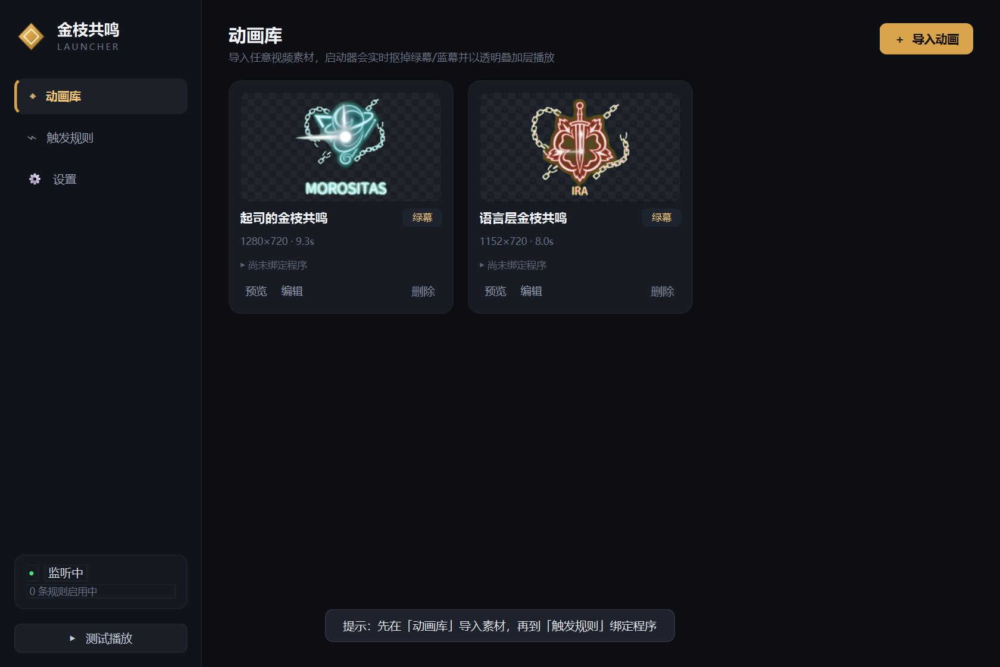

# 金枝共鸣 · 启动器

一个本地运行的 Windows 小工具：**在指定程序启动时，把绿幕素材抠像后以透明叠加层播放到屏幕上**。

- 实时色度抠像：绿幕 / 蓝幕 / 不抠像三种模式，暗部与阴影也会跟着透明（淡出到黑场不会留黑块）
- 屏幕叠加层：无边框、置顶、鼠标穿透，位置与尺寸可调
- **光波扩散**：素材里的冲击波本来会被画框裁断，检测出来后能接着扩到整个屏幕
- **分辨率自适应**：可按屏幕、按被启动的程序窗口、或固定像素三种参照；高 DPI、切换分辨率、窗口缩放都会实时跟随，画面不发虚
- 动画库：随时导入新的视频素材（mp4 / mov / webm / mkv / avi / gif）
- 触发规则：一个程序可绑定多段动画，按顺序或随机播放；支持延迟、冷却、按程序名或完整路径匹配
- 托盘常驻：关窗口不退出，仍在后台监听；可开机自启



## 环境要求

| 项目 | 要求 |
| --- | --- |
| 操作系统 | **Windows 10 / 11（64 位）** |
| Python | **3.10 及以上**（开发与验证使用 3.13） |
| 依赖 | 见 `requirements.txt`，4 个直接依赖 |
| 显卡 / 内存 | 无特殊要求，抠像走 CPU；播放 1080p 素材约 200–300 MB 内存 |

依赖清单（版本约束已写在 `requirements.txt`）：

| 包 | 版本 | 用途 |
| --- | --- | --- |
| PySide6 | ≥ 6.5 | 界面与无边框透明置顶叠加层（Qt 6） |
| opencv-python | ≥ 4.8 | 视频解码 + 实时色度抠像（自带 FFmpeg，mp4/mov/webm/mkv/avi 都能读） |
| numpy | ≥ 1.24 | 图像运算与径向统计 |
| psutil | ≥ 5.9 | 监听目标程序启动 |

只支持 Windows：叠加层的置顶与鼠标穿透、进程枚举、高 DPI 换算、开机自启（注册表）都直接依赖 Win32 API。

## 安装

```bat
git clone https://github.com/yuanlvsx/-.git ResonanceLauncher
cd ResonanceLauncher

python -m venv .venv
.venv\Scripts\activate

pip install -r requirements.txt
python app.py
```

装好之后日常启动双击 **`启动器.bat`**（无黑框）即可——它会优先使用项目里的 `.venv\Scripts\pythonw.exe`，找不到再退回 PATH 里的 `pythonw`，所以换机器、换用户名都不用改脚本。
需要看报错时用 **`启动器-调试.bat`**，它会带控制台运行并在退出后停住窗口。

> 下载依赖慢可以走镜像：`pip install -r requirements.txt -i https://pypi.tuna.tsinghua.edu.cn/simple`
> 不想装完整版 OpenCV 的话，`opencv-python-headless` 也能跑（本工具不使用 `cv2.imshow`）。

## 用起来

1. **动画库** —— 右上角「＋ 导入动画」选视频即可，导入时会自动判断绿幕/蓝幕、自动裁掉片尾的死黑帧。双击卡片可在屏幕上预览。
2. **编辑动画** —— 拖动「容差 / 边缘羽化 / 去绿强度 / 阴影扣除」实时看预览；「掐头 / 去尾」可剪掉多余的首尾。
3. **触发规则** —— 「＋ 新建规则」→ 选程序（可从「运行中…」里直接挑，或浏览 .exe）→ 勾选要播放的动画 → 设置延迟与冷却。
4. **设置** —— 播放位置、尺寸参照、贴边距离、鼠标穿透、检测间隔、开机自启等。

## 尺寸怎么适配不同分辨率

设置里的 **尺寸参照** 决定动画"多大算合适"：

| 参照 | 含义 | 适用场景 |
| --- | --- | --- |
| 屏幕 | 占显示器可用高度的百分比 | 通用的角标动画 |
| 目标程序窗口 | 占被启动程序窗口高度的百分比，位置也相对这个窗口 | 游戏 / 播放器改分辨率、窗口大小不一时 |
| 固定像素 | 永远 N 像素高 | 多屏、直播推流等需要固定大小 |

「目标程序窗口」模式下，触发时会先按进程（含启动器派生的子进程）找到那个程序的窗口并锁定它；
窗口之后怎么改分辨率、拖动、缩放，动画都会实时跟着重排，窗口被关掉或最小化则自动退回屏幕参照。

另外，解码尺寸会按屏幕的缩放比例走物理像素（125% / 150% / 200% 都不会发虚），
切换分辨率或插拔显示器时叠加层也会自动重算，不需要重启。

## 光波扩散到全屏

素材里的"发射"是一圈从 Logo 向外扩散的光环，到画幅边缘就被裁断了。开启 **光波扩散** 后，
播放到那一下时叠加层会临时铺满整个参照区域（屏幕 / 目标窗口），把光环接着往外画，
一路扩到屏幕外再淡出——看起来就是整个桌面被这一圈冲击波扫过。

- 导入时自动检测有没有这种光波；「编辑动画」里能看到检测到的时间窗和扩散速度，也可以勾掉开关或点「重新检测」。
- 检测的做法：把画面按极坐标展开，量出每个半径上的发光强度（相对绿幕底色多出来的那部分光），
  逐帧跟踪光环的半径，再在参考帧上按角度对齐叠加出它的径向截面（颜色 + 柔和度）。
  播放时把这截面按当前半径平移重绘，所以粗细、颜色和素材完全一致，接缝处看不出拼痕。
- 光环的圆心不一定在画框正中（语言层那段就偏下约 5%），检测会把这个偏移一并量出来，
  否则细环会被量成一条宽色带、接缝处错开成两根线。
- 光波只在"光源离开画框"之后才补画，之前的帧完全交给素材，所以不会出现两层光环叠在一起。
- 要追加新素材时不用额外设置：导入 → 自动检测 → 默认开启。

## 抠像参数怎么调

| 参数 | 作用 | 调整方向 |
| --- | --- | --- |
| 容差 | 判定"这是幕布色"的色度范围 | 边缘残留绿 → 调大；主体被吃掉 → 调小 |
| 边缘羽化 | 边缘过渡宽度 | 边缘生硬/锯齿 → 调大 |
| 去绿强度 | 抑制残留在主体上的绿色反光 | 头发、白边发绿 → 调大 |
| 阴影扣除 | 把压在绿幕上的半透明暗部/阴影也变透明 | 主体周围有暗块 → 调大 |

素材自带淡出到黑场时，保持「淡出到黑场」逻辑开启（默认）即可，黑场会自动透明；也可以直接在「去尾」里剪掉。

## 文件说明

```
ResonanceLauncher/
├── 启动器.bat          启动（无控制台）
├── 启动器-调试.bat     启动并显示日志
├── app.py              入口
├── requirements.txt    运行依赖
├── .gitignore          排除本机数据（config.json / assets / cache）
├── config.json         动画 / 规则 / 设置（自动生成）
├── assets/             导入的素材副本
├── cache/              缩略图缓存（可随时删除）
├── core/               抠像引擎、播放线程、进程监听、尺寸自适应（layout.py）、光波检测（burst.py）
├── ui/                 主界面、叠加层、对话框
├── docs/               截图
└── tools/              自检 / 调试脚本（selftest_*.py、preview_seam.py、seam_error.py）
```

## 关于仓库内容

推到 GitHub（首次发布）：

```bash
git init
git add .
git commit -m "initial commit"
git remote add origin https://github.com/yuanlvsx/-.git
git push -u origin main
```

`.gitignore` 已经把 `.venv/`、`config.json`、`assets/`、`cache/` 和调试截图都排除了，`git add .` 不会把本机数据带上。

- `config.json`、`assets/`、`cache/` 都是运行时在本机生成的**个人数据**（记录着你绑定的程序路径、导入的素材、缩略图），已写进 `.gitignore`，不会被提交。
  首次启动时程序会自动生成一份默认的 `config.json`、`assets` 与 `cache` 目录，所以克隆下来直接就能跑。
- 仓库不附带任何视频素材：素材版权归原作者所有，请导入你自己有权使用的绿幕片段。
- 自检脚本（`tools/`）不是运行必需，只在改代码时用来验证抠像、光波检测与对话框布局。

## 排错

| 现象 | 原因与处理 |
| --- | --- |
| `ModuleNotFoundError: No module named 'PySide6'` | 依赖没装，或没激活虚拟环境：`.venv\Scripts\activate` 后 `pip install -r requirements.txt` |
| 双击 `启动器.bat` 闪一下就没了 | 既没建 `.venv`，PATH 里也没有 `pythonw`。先用 `启动器-调试.bat` 看报错 |
| 导入视频报解码失败 | OpenCV 走的是自带 FFmpeg，个别 HEVC 素材需先转成 H.264 的 mp4 |
| 动画被游戏挡住 | 独占全屏（Exclusive Fullscreen）会盖住任何置顶窗口，改用无边框窗口模式 |
| 换显示器 / 改分辨率后位置跑偏 | 设置里重新选一次「屏幕」，或重启程序让叠加层重算 |

## 小提示

- 默认「鼠标穿透」开启，点击会落到下面的窗口；要拖动叠加层，去设置里关掉穿透、并把播放位置选成「自定义」。
- 浏览器、更新器会不断派生同名子进程，所以默认只在"该程序原本没在运行"时触发；确需每次都触发可在规则里勾选对应选项。

注意：以上全部内容都是AI创作

PS：说一点题外话，如果我的全部任务都交给AI去执行的话，我感受不到任何创造的喜悦。之前我会为搭建一ncatbot为框架的qq机器人花上一整天时间，当我的机器人能够执行指令的时候，我真的很开心。然后之后我试着去写插件，虽然同样也是使用了AI，但我能明显感觉到我自己在参与其中，我有一种自己在很好使用AI的感觉。可是当我真正试着放手全部让AI去执行的时候，我只感到一种丧失感，我什么都没有参与，可是AI把一切都做的很好，至少我从门外汉的角度看起来如此。我什么都不是，或许我才是被使用的工具，我只是为了给AI提示词让他执行任务才存在的（未来甚至都没这个必要了）。唉唉，我感到挺难过的，虽然也无能为力就是了。回到这个工具的话，虽然没有完美实现我想象中的效果，可是碍于手上也确实没有游戏素材，也就止步于此吧，至少也算实现了基本的需求，AI甚至还给我进行了适当拓展。感谢能听我发牢骚到这里的你，谢谢。

Ciallo～(∠・ω< )⌒★